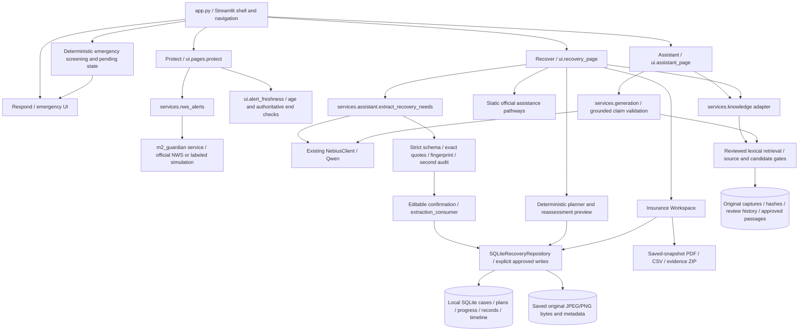

# ReadyRelief — Final Project Report

**Protect. Respond. Recover.** Five-member Mastering Agentic AI course prototype. Audit date: November 6, 2026. Authoritative implementation: merged `main`, `be0b99adbe2bb9ffe6e97716f59649db86fcce85`. This report describes code and observed behavior, not a production-readiness certification.

## Executive summary

ReadyRelief connects disaster awareness, immediate emergency information, and longer-term household recovery in one Streamlit application. It combines official NWS lookups, deterministic emergency interruption, narrowly validated Qwen assistance, human-reviewed source excerpts, and explicitly approved local Recovery records. Insurance preparation reuses confirmed damaged items and exports a preparation PDF, inventory CSV, and ZIP containing the actual saved photographs.

The complete fictional household journey was exercised against the production application in desktop and mobile Chromium. This audit used the supported structured fallback, not paid Qwen calls or substituted model responses. The fresh Python suite passed **1,024 tests, with 11 skipped and 10 subtests passed**. The visual suite passed **62 tests, with one existing skip**. Detailed evidence, commands, and limitations appear in [Final Verification](READYRELIEF_FINAL_VERIFICATION.md); the reproducible walkthrough is [Full Happy Path](READYRELIEF_FULL_HAPPY_PATH.md).

## Problem, users, and objectives

Households dealing with flooding need understandable next steps, reliable official information, continuity across visits, and help organizing damage information. Stress, fragmented resources, uncertain safety, and incomplete household details make a large intake form or unrestricted chatbot poor starting points.

The prototype serves fictional Miami-Dade/Florida disaster-recovery households, including people with mobility needs and those staying away from damaged property. It aims to reduce initial effort, distinguish reported facts from model proposals, preserve progress, and organize information for an insurer. It does not determine household safety, eligibility, insurance coverage, shelter capacity, or emergency dispatch.

## Architecture

Emergency controls are rendered independently of optional model, retrieval, and database operations. Qwen produces proposals or constrained explanations; it has no direct persistence or approval authority. Recovery writes go through the repository, with state/version checks inside the relevant transaction.

### Main implementation boundaries

| Boundary | Actual implementation and responsibility |
|---|---|
| Application | `app.py`; `ui/capabilities.py`, `ui/shell.py`, `ui/pages.py`: seven screens, navigation, theme, chat dock, tour |
| Protect | `services/nws_alerts.py`, `m2_guardian/service.py`, `ui/alert_freshness.py`: normalized alerts, explicit lookup, retained-result freshness |
| Respond | `emergency/service.py`, `emergency/workflow.py`, emergency presentation: deterministic escalation and official information pathways |
| Shared AI | `services/assistant.py::propose`, `extract_recovery_needs`; `services/generation.py::explain`; `recovery/llm_client.py::NebiusClient` |
| Trusted knowledge | `knowledge/service.py`, `retrieval.py`, `candidates.py`, `review.py`, `store.py`; `services/knowledge.py` adapter |
| Recovery | `ui/recovery_page.py`; `recovery/models.py`, `assessment.py`, `demo_planner.py`, `extraction_consumer.py`, `reassessment.py`, `database.py` |
| Insurance | `ui/insurance_workspace.py`; `recovery/insurance_models.py`, `attachments.py`, `insurance_exports.py`; existing Recovery repository |

Exact function/line index for inspected modules: [CODE_REFERENCES.json](audit/CODE_REFERENCES.json). Line numbers apply to the audited commit, not a future version.

## Capability inventory

Classification: **V** = IMPLEMENTED AND VERIFIED in this audit by browser or regression tests; **U** = IMPLEMENTED BUT NOT VERIFIED with a live external service in this audit; **S** = SIMULATED DEMONSTRATION; **E** = EXTERNAL SERVICE DEPENDENT; **P** = PARTIALLY IMPLEMENTED; **O** = NOT IMPLEMENTED / OUT OF SCOPE. Multiple labels distinguish local implementation from external execution.

| Capability / exact entry point | Implementation, data, and AI | Persistence / configuration | Status, evidence, and limitation |
|---|---|---|---|
| Home | `ui.pages.home`; product overview, primary navigation | Session state; no key | V: desktop/mobile actual browser and visual suite |
| Navigation/search | Shell/search helpers; deterministic page routing | Session page and conversation; no key | V: navigation-only requests execute immediately; data-changing actions retain confirmation boundaries |
| Themes, responsive UI, chat dock | `ui/shell.py`, styles; bright/dark, mobile layout | Session settings | V: visual suite; not a formal accessibility certification |
| Guided tour / narration | Tour components, browser speech support | Session progress/mute | V/S: scripted product tour, not autonomous AI; speech support/browser permission varies |
| Evidence screen | `ui.pages.evidence`; integration descriptions, official entry links and prototype limits | Static descriptions / no model | V/P: all-screen visual coverage; some CDC-only/older-PR wording is stale. This is not the Insurance photograph library |
| Household | `ui.pages.household`; label, members, mobility, vehicle, pets, location preferences | Session only | V/P: separate from confirmed durable Recovery household facts; defaults are not inferred confirmations |
| Protect simulated scenario | Protect → `Show simulated alert`; Guardian simulation fixtures | Session snapshot | V/S: browser-tested; explicitly labeled SIMULATED SCENARIO, not current government data |
| Protect official lookup | Protect → official NWS check/recheck; existing Guardian HTTP integration | Session snapshot; network | V locally / U/E live: synthetic deterministic tests passed; this audit made no live NWS verification |
| Freshness | `ui/alert_freshness.py`; lookup age, `ends_at`, `expires_at` | Evaluated on rerender | V: age >5 minutes stale; exactly five minutes accepted if otherwise valid; authoritative end/expiry reached is stale. Invalid/future metadata fail closed |
| Alert source and no-alert state | Protect source/timestamp presentation | Original official values preserved | V: no alerts does not mean safe; NWS alert is not a county evacuation order; idle page needs rerender/recheck |
| Immediate emergency controls | `Call 911`, `I Can't Call 911`; Respond and persistent shell | No login, location, intake, AI, or DB prerequisite | V: both reachable in actual browser and emergency visual tests; no call placed; no dispatch integration |
| Danger interruption | `emergency.service` and workflow; deterministic actual-danger screening | Session pending danger; persisted Recovery restriction | V: regression tests cover failed danger persistence, reruns, stale confirmations. No routine danger-clearance feature |
| Emergency resource information | Respond options; static official entry links and reviewed-resource boundary | No live capacity data | V/P: directory-backed information; pending reviewed contact listings cannot publish. Not a guaranteed local emergency service |
| Assistant actions | `services.assistant.propose/execute`; constrained action schemas | Session conversation; approved actions route through services | V/U/E: local/navigation and mocked provider tests; no fresh Qwen call |
| Conversational Recovery extraction | `Continue to Review` → `request_extraction` → shared M1 extractor → M5 review | No automatic raw-chat/fact save; Nebius key required for live extraction | V fallback / U/E live: schema, quote/count/context/audit tests pass. Real extraction was verified before this audit, not repeated here |
| Unknown household details | Nullable facts and proposed/unchanged/unknown fields | Persist only selected confirmed values | V: adults explicitly three in demo, children unknown; total household count cannot invent adult/child split |
| Reviewed RAG | `services.knowledge.retrieve_guidance`; phase/hazard/geography + deterministic lexical matching | On-disk approved captures/candidates; no model required | V/P: six eligible approved passages; narrow coverage and lexical paraphrase misses |
| Grounded Qwen explanation | Existing supported source-explanation UI → `services.generation.explain` | Approved public evidence, strict claim/citation validation; Nebius key/network | V local tests / U/E live: not exercised with a paid model; no unsupported fallback answer |
| Structured new intake | Recover → structured fallback → `Create draft plan` | Saves an explicitly submitted assessed case and draft; no active tasks until approval | V: real desktop/mobile browser |
| Confirmed Recovery details/damage | `Document damage`, optional household details, `Add Damaged Item` | SQLite records and versions; explicit confirmation | V: three adults, two separate dated damage records; no typed age/walker field, stored in confirmed narrative |
| Personalized planning (CAP-07) | `Generate fresh recovery plan`, rationale, priorities, dependencies, official pathway links | Deterministic confirmed-fact planner; draft review | V: no filler transport/eligibility assumptions; accommodation already arranged produces no unmet housing task |
| Plan approval | `Approve my recovery plan` | APPROVED plan activated transactionally | V: draft/extraction alone activates no tasks; stale snapshots rejected |
| Progress (CAP-08) | `Your Recovery Progress`, task status, `Save progress` | Four statuses, stable task IDs, history | V: Completed browser-tested through reopening; all four statuses covered by regression tests; completion is user-reported |
| Resume | Saved case ID → `Resume My Recovery` → `Open saved recovery` | SQLite, not browser session alone | V: profile, tasks and actual photo survive refresh/resume; case ID is not authentication |
| Timeline | `Recovery timeline` | Accepted Recovery events in same transaction; UTC | V: observed task-progress event; legacy data not fabricated/backfilled; not every Insurance edit is a timeline event |
| Reassessment (CAP-09) | `Circumstances changed? Review an update` → preview → `Approve this revision` | Optimistic concurrency, accepted assessment/history, previous plans retained | V: Unknown→Available electricity browser-tested; completed task ID/status retained; restoration never certifies safety |
| Official Assistance Finder | `Find Help Now`; independent housing/disaster/electricity/water filters | Five static official link pathways, check date 2026-11-04; no Qwen or approved plan needed | V: general links for unknown county; Miami-Dade-only resources require appropriate county; not M3-reviewed guidance or live availability |
| Insurance Details | `Prepare for insurance` → `Insurance Details` | Optional insurer/policy/incident profile; confirmed SQLite save | V: Demo Mutual and DEMO-POL-001 survive reopening |
| Damage Inventory | `Damage Inventory` → `Edit Details` | Reuses existing confirmed damage IDs; optional estimates/room/details | V: Refrigerator Kitchen $450; Sofa Living room $200; no loss valuation/coverage decision |
| Evidence & Documents | Stage of same name; actual JPEG/PNG upload, preview, confirmation, saved download | Original bytes in SQLite BLOB; hash and case/item ownership | V: actual synthetic PNG upload/retrieval/export; receipt tracked as not uploaded; no PDF attachment/OCR/photo analysis |
| Communication log | `Save Communication` | Explicit user-reported entries, append-only constraints | V: fictional call summary saved; no insurer contacted |
| PDF / CSV / ZIP | `Review & Download` → three download buttons | Saved snapshot only; ReportLab/Python ZIP; no model | V: downloaded files inspected; original PNG byte/hash match; report is not a submitted claim |
| Submission, dispatch, live placement | No supported entry point | None | O: no insurer submissions, coverage/eligibility determinations, live hotel/shelter beds, real-time provider restoration, or emergency dispatch |

## Protect → Respond → Recover

Protect supports explicit official lookup and labeled simulation; the on-demand model avoids hidden background network calls. A retained snapshot becomes stale on rerender when its age exceeds five minutes or an authoritative end/expiry is reached. A continuously idle page cannot update its display, so the interface explains that it is not continuously monitored and offers rechecking.

Respond is always available. Deterministic emergency screening takes precedence over normal Recovery and model calls. Pending danger blocks ordinary writes even if recording that danger fails. Persisted danger is reloaded and checked at repository approval boundaries, not cleared by incoming `danger=False`, utility restoration, or a model proposal.

Recovery is a guided journey: describe → review/structured input → confirmed records → draft plan → explicit plan approval → track progress. Returning users resume confirmed state, review proposed changes, and approve a revision without losing completed or unrelated work. The effective-task projection distinguishes current applicability from historical status; resolved accommodation does not silently mark a historical task Completed.

The observed five-task plan comprised **Review safe recovery boundaries**, **Record utility availability and gaps**, **Organize known damage information**, **Prepare an insurance discussion draft**, and **Review saved recovery records and follow-ups**. It did not invent a current housing need for a household already staying with friends. Electricity was initially Unknown; its explicitly approved Available update retained completed work. Insurance then added details and evidence without replacing the accepted plan.

## AI and reviewed knowledge

M1's shared Qwen infrastructure uses the existing `NebiusClient`, not another planning agent. Current assistant/extraction/generation model selection uses `NEBIUS_CHAT_MODEL`, then `NEBIUS_MODEL`, then `Qwen/Qwen3-235B-A22B-Instruct-2507`. The standalone legacy experimental planner has its own model default within the same client architecture; it is not the integrated deterministic plan generator.

Recovery extraction validates strict structured fields, exact supporting quotations, household counts, original context fingerprints, and a second model audit. It performs no persistence. M5 stages editable proposals and requires explicit confirmation; stale proposals cannot overwrite saved state. Missing configuration leaves a usable structured workflow. This audit deliberately unset `NEBIUS_API_KEY` and observed the real “AI extraction is not configured” fallback; no synthetic provider replaced production extraction.

M3 retains original HTTP bytes, hashes, extracted parent sections, exact candidate spans/context, and review history. Publication requires both parent-source and individual-candidate approval plus valid provenance, applicability and review state. Only individually approved passages and permitted safety caveats enter public outputs. Full unapproved parent context remains administrative. Source and candidate public caveat projections preserve substantive limitations without rewriting historical review-queue records.

There are **eight source records**, seven preserved captures with matching original hashes, and one unavailable FCC record without downloaded bytes. Six passages pass current publication validation: five CDC reentry passages and one USAGov transitional-housing passage. **Twenty-three candidates remain PENDING**, including NFIP and held neighboring text. No approvals changed during this audit. The existing attribution addendum explains historical USAGov reviewer placeholders; original approval snapshots remain unchanged.

Lexical retrieval can abstain despite related evidence existing: “What does official guidance say about qualifying for transitional housing?” returned NO_RELEVANT_EVIDENCE. “Where can I find temporary housing after flooding?” returned INSUFFICIENT_EVIDENCE with one exact USAGov citation, not a live housing placement answer. The citation is conditional on FEMA registration and does not establish qualification. See [knowledge audit](audit/KNOWLEDGE_AUDIT.json).

## Insurance preparation and storage

The four connected stages are Insurance Details, Damage Inventory, Evidence & Documents, and Review & Download. Optional fields stay unknown. Existing damage is reused, item-specific details are versioned, and each durable change requires confirmation. Case, records and workspace snapshots guard combined updates; validation failures roll back attachments and metadata together.

Only JPEG/PNG photographs are supported: five MiB per file, twenty files and fifty MiB per case, with dimension/pixel bounds and actual image-content validation. Original bytes are retained, including possible EXIF/GPS metadata. A safe exported filename and SHA-256 connect the PDF evidence index, ZIP manifest and actual attachment. A reported receipt without a file is explicitly not attached. The PDF uses structured sections, item tables/details, evidence traceability and a non-submission disclaimer; CSV neutralizes formula injection. Embedded fonts improve common Unicode handling but do not promise universal script/font coverage.

This is local prototype storage, not authenticated or encrypted production document hosting. No malware scanning, retention service, insurer API, OCR or photographic damage analysis is implemented. Hosted ephemeral disks can lose SQLite data. Case IDs provide lookup, not authorization.

## Contributions and agentic design

Available code identifies M1 shared assistant/extraction/generation, M2 Guardian, M3 reviewed knowledge, M4 emergency assistance, and M5 Recovery/Insurance. Selected M6–M9 work from teammate commit `8227671` was adapted for effective-task consistency, stronger versions, timeline and compatible reassessment. This does not establish nine team members or individual ownership names. The five-member project must supply its own personal contribution attribution.

The selective integration deliberately excluded fictional replay/session switching because of its pending-danger risk. It did not merge an entire alternate application or add a planning-agent framework. A script, API call or deterministic planner is not automatically an autonomous agent. The project demonstrates bounded AI assistance with human review and deterministic safety/persistence orchestration. It uses neither LangGraph nor MCP nor runtime multi-agent orchestration.

## Validation, challenges, and limitations

Validation combines Pydantic schemas, offline fake-provider tests, SQLite rollback/concurrency tests, Streamlit AppTest, screenshot/interaction tests, and this actual production-app Chromium journey. Fresh totals are recorded in [verification](READYRELIEF_FINAL_VERIFICATION.md). The downloaded PDF pages and browser screenshots were visually inspected; original attachment bytes were compared to the ZIP and manifest.

Important engineering choices address concrete problems: deterministic danger guards before optional AI; authoritative database safety checks; context/version fingerprints against stale tabs; individual publication gates against neighboring-context leakage; effective-task projection against historical/current contradictions; and saved-snapshot export against unconfirmed data leaks.

Remaining limitations include narrow reviewed coverage and lexical recall; no live external service verification in this audit; a structured fallback rather than fresh Qwen execution; no idle-screen automatic freshness update; no authentication/production document security; session-only general household preferences; age/mobility detail represented as confirmed narrative rather than a complete accessibility profile; limited attachment formats/fonts; and no dispatch, eligibility, insurance submission or real-time resource capacity.

Future work should prioritize authentication/storage/retention controls, reviewer-backed source coverage and retrieval evaluation, accessibility testing with users, explicit deployment persistence, and teammate-approved contract changes. These are recommendations, not completed features. The current implementation is a demonstrated educational prototype with a reproducible local household journey, not an operational emergency service.

## Reproducible AI evaluation

The [Final AI Evaluation Report](evals/READYRELIEF_AI_EVALUATION_REPORT.md), [dataset](evals/READYRELIEF_EVAL_DATASET.json) and [per-case CSV](evals/READYRELIEF_EVAL_RESULTS.csv) provide 40 independently specified scenarios against this same main baseline: 14 extraction-validation, 14 retrieval/grounding and 12 workflow cases. **39 passed and one failed**; this is a scenario result, not an overall AI accuracy score.

The runner uses authored model/audit fixtures for validation, the real reviewed M3 store for retrieval, and existing isolated application regressions for workflow. There were 16 OFFLINE MODEL FIXTURE executions, 24 DETERMINISTIC APPLICATION CHECK executions and zero LIVE MODEL executions. Field/state checks passed 7/7, unknown preservation 133/133, quotations 8/8, positive retrieval 5/6, expected abstentions 8/8, and returned source/citation checks 6/6. One deliberately malformed fixture reply was correctly rejected (12/13 first replies were schema-valid).

R04 remains a retrieval-recall failure: the transitional-housing paraphrase returns NO_RELEVANT_EVIDENCE despite an approved USAGov passage. Application ranking and approval gates were not changed to improve scores. The single exact-copy grounding control is not a general faithfulness measurement; the rejecting entailment judgment is a fixture. **Live Qwen model accuracy was not measured in this run.** Independent generation quality, live provider availability and operational resource conditions remain unmeasured. Run `python -B evaluation/run_final_evaluation.py` from the repository root; exit code 1 intentionally records R04. The evaluator is not added as a mandatory green CI job.
