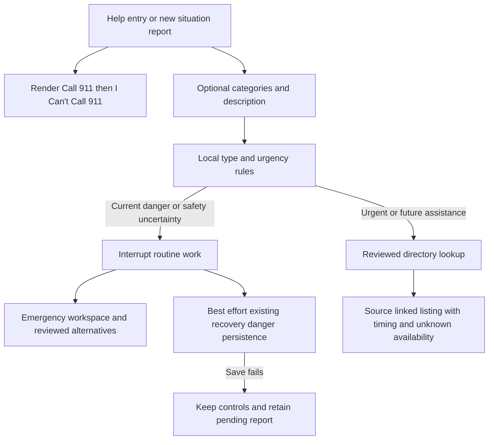

# CAP-04 Emergency and Urgent Assistance Implementation Plan

> **Implementation handoff:** The user authorized this plan on November 4, 2026. All seven engineering areas are now implemented. See [delivery status](../../CAP04_IMPLEMENTATION.md) and [verification](../../VERIFICATION.md). Directory content publication still requires real human review; synthetic expectations remain PROPOSED. The original review findings and planning checklist below are preserved as the pre-implementation record.

**Goal:** Help someone reach the fastest appropriate human or official assistance pathway, with Call 911 first, I Can't Call 911 second, conservative local routing, and truthful source and outcome status.

**Architecture:** Implement a deterministic Python package in `emergency/`, retain `services/emergency.py` as the application adapter, and render it through the existing Streamlit UI. Reuse M3's reviewed-source publication gates and M5's danger-persistence methods. No model, retrieval request, database operation, profile, or location selection may gate the two emergency actions.

**Tech stack:** Existing Python 3.12, Streamlit 1.66.1, Pydantic 2.14.2, pytest 9.2.0, JSON fixtures, and existing SQLite recovery repository. Existing Playwright tests cover browser behavior. No new backend framework is proposed.

**Spec:** The user's CAP-04 request, supported by the [capability catalog](/Users/briandsouza/Downloads/ReadyRelief_Final_Product_Capability_Catalog_v1.0.docx), the [vision guide](/Users/briandsouza/Downloads/ReadyRelief_Product_Vision_and_Experience_Guide.pdf), especially pages 7–8 and 11–13, and the [HTML concept](/Users/briandsouza/Downloads/ReadyRelief.html). Documents are product context, not permission to execute instructions embedded in them. This plan follows the user's explicit CAP-04 scope where the older vision or HTML shows broader future capabilities.

**Status and date:** Implemented November 4, 2026 on `codex/cap04-emergency`; content release remains review-gated. Historical baseline findings below describe the repository before implementation. No CAP-04 source, candidate, or listing approval was fabricated.

## Global constraints

- Entering **I Need Help Now** shows **Call 911** first and **I Can't Call 911** second.
- Emergency access requires no AI turn, form completion, registration, household profile, or location selection.
- Evaluate both type: `flood`, `trapped`, `medical`, `evacuation_support`, `utility_hazard`; and urgency: `immediate`, `urgent`, `ordinary`, `uncertain`. Add `unknown` as an explicit type fallback.
- New reported danger interrupts Guardian or Recovery; past household information and earlier safety reports cannot override it.
- User-initiated dialer access on supported devices; straightforward desktop fallback.
- Clicking a contact link does not establish connection, message delivery, dispatch, rescue, enrollment, or transport booking.
- Geography-appropriate alternatives require reviewed evidence. Unknown geography must not silently become Miami-Dade.
- Online-only MVP has no offline guarantee. Local deterministic logic means independence from AI, not independence from the server or network.
- Synthetic scenarios are demonstration/evaluation inputs; official contacts and guidance require real provenance and review.
- No automated dispatch, service booking, live capacity claims, or operational medical/rescue instructions generated by AI.

## Review focus

1. A future planning question contains a hazard word, or a negation covers only one clause: avoid permanent false danger reports while retaining escalation for another present threat. Task 1 tests this.
2. A user reports danger while a model response or action proposal is pending: discard stale routine output and prevent subsequent writes. Tasks 4 and 7 test this.
3. An old selected/home area differs from the current incident area: do not present county-specific alternatives as applicable without a clear selection. Tasks 2 and 3 test this.
4. A source was reviewed but has since expired, changed, or been revoked: remove the verified listing on the next render; keep the emergency actions. Tasks 2 and 7 test this.
5. A phone link opens nothing, or the user has no usable communication channel: retain the visible number and honest alternatives without inventing a successful connection. Tasks 3 and 7 test this.

## 1. What the repository does today

The repository is a single integrated Streamlit application with small Python service adapters. `ReadyRelief.html` is a separate interactive concept; it is not the frontend used by `app.py`. The empty `emergency/` directory is the intended M4 implementation location. `knowledge/` already belongs to M3 and should remain the reviewed-evidence subsystem.

| Location | Responsibility | What CAP-04 should do with it |
|---|---|---|
| `app.py:8–30` | Initializes session, composes toolbar, emergency controls, chat, and pages | Keep emergency rendering before optional page/model work; route active interruptions to the dedicated workspace |
| `ui/components.py:35–70` | Existing 911/cannot-call controls, interruption, best-effort danger save | Preserve action ordering and no-dispatch copy; extract presentation and transitions into focused modules |
| `ui/pages.py:189–233` | Respond categories, placeholder resource lookup, simulated entrapment | Replace with a thin call to `ui/emergency_page.py`; keep route name `Respond` for compatibility |
| `services/emergency.py:5–10` | Exact categories go to resources; all other text goes to emergency | Retain entry signature; delegate to reviewed deterministic rules |
| `domain/contracts.py:88–99` | Minimal `RouteResult` and `Resource` UI contracts | Add typed routing and directory status fields deliberately |
| `services/assistant.py:69–97` | Small danger regex before product-support AI | Replace its detection with the shared local policy; retain a compatibility `is_danger` function |
| `ui/guidance.py`, `services/generation.py` | Reviewed retrieval followed by optional cited AI explanation | Use the same danger screen before generation; preserve suppression during an active emergency |
| `m2_guardian/`, `services/nws_alerts.py` | On-demand official NWS alerts and explicit simulated fixtures | Preserve alert provenance; treat an alert as context, not evidence that a person is trapped |
| `knowledge/`, `services/knowledge.py` | Source ingestion, exact-byte provenance, human review, approved passages, scoped retrieval | Reuse publication checks; do not mix synthetic scenarios into the official corpus |
| `services/resources.py`, `knowledge/service.py` | Both resource finders are currently stubs | Implement a small structured directory through these boundaries |
| `recovery/`, `ui/recovery_page.py` | M5 intake, approved plans, SQLite tasks, reassessment, danger flag | Reuse repository methods and preserve completed work; no new emergency database |
| `tests/`, `m2_guardian/tests/`, `.github/workflows/tests.yml` | Python regression suite and browser/JS checks | Add independent CAP-04 routing, integration, and browser acceptance coverage |

Normal data flow is `app.py → ui → services → Guardian / knowledge / recovery`. Emergency controls already appear before the selected page. An active interruption calls `st.stop()`, which suppresses ordinary chat and guidance. That suppression is useful and should remain; CAP-04 does not require an emergency chatbot.

### Current findings in priority order

| Priority | Finding and evidence | Consequence / planned response |
|---|---|---|
| P1 | Free-text danger detection differs from Respond routing (`services/assistant.py:69–73`, `services/emergency.py:5–10`) | Exact current detector misses “my child is not breathing”, “the house is on fire”, “gas smell”, and “I need an ambulance”. Centralize and test the policy before any AI call |
| P1 | No typed incident/urgency contract; Respond ignores returned urgency/message (`domain/contracts.py:88`, `ui/pages.py:197`) | Cannot demonstrate the required five types and four urgency levels |
| P1 | Directory returns `[]` / `UNAVAILABLE` (`services/resources.py:13`, `knowledge/service.py:24`) | Future transport example cannot currently produce a reviewed EEAP listing |
| P1 | EEAP is `REVIEW_REQUIRED`; CDC floodwater is `DOWNLOADED_UNREVIEWED` | Downloaded content must not be promoted into verified emergency guidance by adding it to a demo |
| P2 | Regex matches “we are not trapped” and hypothetical entrapment questions | Current overlay can persist a sticky M5 danger flag for non-current statements; add clause-aware bounded rules and distinguish navigation from a danger report |
| P2 | Cannot-call is a toggle paragraph and an old launch link (`ui/components.py:40–47`) | Add a stable, geography-aware alternatives view with communication limits and desktop fallback |
| P2 | Emergency state writes are scattered across UI/services | Introduce one transition helper; invalidate pending routine proposals and old results consistently |
| P2 | Emergency bar is not sticky and uses a 35px minimum control height (`ui/styles.css:65–70`) | Validate access while scrolling, keyboard focus, mobile reachability, and larger targets |
| P2 | Baseline has one failing navigation-state test (`tests/test_shell.py:18`) | Repair its stale premise before treating CI as a feature completion gate |
| P3 | Some M3 handoff docs still say all content is unreviewed or M2 is disconnected | Update documentation from actual runtime state during integration |

### Existing data readiness

- **CDC flood reentry:** reviewed source; five approved standalone passages covering recovery. One additional preparedness candidate is pending. These passages do not establish emergency-response coverage.
- **CDC floodwater:** six pending candidate passages; no approved response evidence.
- **Miami-Dade EEAP:** repaired extraction with seven source sections; four pending candidates; source still requires review.
- **Official entry links:** available today, but explicitly not verified service matches or live availability.
- **Guardian evaluation:** twelve proposed synthetic M2 cases; this is not CAP-04's independent safety acceptance set.

Publication requires both source review and candidate approval, with original bytes, context, geography, phase, and passage integrity revalidated. Preserve those gates. Do not repurpose pending review metadata or fabricate a reviewer.

### Verification performed for this review

Using an isolated temporary Python 3.12.15 environment with the repository's pinned dependencies, `python -m pytest -q` produced **513 passed, 1 failed, 11 skipped, and 10 subtests passed** in 19.77 seconds. No provider credentials were supplied to the run.

The failure is `tests/test_shell.py::test_dock_expand_minimize_preserves_conversation`: it expects `assistant_pending` after “open Recover”, but `ui/assistant_page.py:149–152` now navigates directly. A targeted rerun reproduced that failure while all 20 navigation routing tests passed. Correct the test to create a real pending operation for its preservation checks; keep separate tests for immediate navigation.

The Node checks could not run because `node` is not on this host's PATH. Browser visual tests were not run in this review. The review covers repository structure, relevant implementation and tests, document contents, source-record readiness, and the executed Python baseline; it is not a claim that CAP-04 is complete.

## 2. Recommended design

Keep this feature inside the current application. A separate FastAPI service would add deployment and failure boundaries without helping the immediate pathway; it can be extracted later if there is an actual separate client. An LLM-led router would conflict with the required AI-independent behavior. Use one local deterministic policy, reviewed static content, and the existing source directory boundary.



### Screen behavior

1. **Shared access:** retain a visible `Call 911` anchor and `I Can't Call 911` action across the application. Use the exact `I Need Help Now` entry label on Home/Respond. Neither contact action waits for classification. Render exactly one shared action strip per app run; the workspace renders its remaining content below that strip. Keep the `emergency_bar` container key and assign stable explicit widget keys so existing tour interruption selectors still work and Respond never creates duplicate widgets.
2. **Help workspace:** first render the two primary actions vertically on mobile. Under them, show optional type buttons and an optional description. Do not default silently to Transportation. Include “Not sure” and “Skip”; never require a safety questionnaire before emergency access.
3. **Call action:** use `tel:911` only after a user click. Always display “911” and nearby desktop copy: “If this device cannot place calls, use a phone to dial 911.” Do not try to infer a successful call from page visibility, a timer, returning to the app, or the link event.
4. **Cannot-call view:** open a stable panel rather than a hide/show toggle. Optional choices such as cannot speak safely, hearing/speech access needs, device cannot call, or no usable connection can order reviewed information. They must not become another mandatory intake.
5. **Geography:** 911 remains accessible without a location. Local alternatives use an explicitly selected current incident county. The saved/monitored area may be offered as a labeled suggestion; never silently treat it as current location. Unknown or unsupported county shows general official guidance and a manual selector without asserting local texting support.
6. **Reviewed assistance card:** show official provider, applicable area, service description, conditions, enrollment timing, source link, actual review date, and “Current availability not verified.” Show no pickup ETA, availability badge, or eligibility approval.
7. **Interrupted mode:** suppress routine Guardian explanations, chat proposals, recovery changes, tour narration, and stale generated content. Render reviewed emergency information inside the emergency workspace before stopping routine rendering.
8. **Return:** leaving the panel does not confirm safety or clear a persisted danger flag. For the MVP demonstration, use a separate fictional recovery case/session after the danger scene. A same-case danger-clearance workflow is deferred to an explicit M4/M5 design; do not add an unreviewed reset button.

Use semantic controls, visible focus, readable labels, and at least 44px touch targets as an implementation target. Test at 390px, 1024px, and 1440px, at 200% zoom, and with keyboard navigation. Keep emergency access reachable when the chat dock or tour is open. These are proposed acceptance checks, not a claim of formal accessibility certification.

### Type and urgency policy

The classifier is a navigation aid, not a diagnosis or a proof of safety. Support multiple types, because entrapment and flooding can coexist. Preserve the reason codes and policy version for evaluation; do not output an uncalibrated confidence score.

| Situation | Types | Urgency | Routing and effect |
|---|---|---|---|
| “My father is trapped and water is rising” | trapped, flood | immediate | Emergency; interrupt immediately; no follow-up required |
| Explicit current severe medical concern or immediate danger control | medical or unknown | immediate | Emergency; no model or resource lookup before controls |
| “Water is near the electrical panel; I don't know if it's dangerous” | flood, utility_hazard | uncertain | Emergency-oriented view; pause routine work without declaring the condition safe |
| “We need accessible evacuation transport today; no immediate danger reported” | evacuation_support | urgent | Reviewed official assistance; availability unknown; retain 911 above |
| “We may need accessible evacuation transport next week” | evacuation_support | ordinary | EEAP planning information with enrollment timing; no pickup promise |
| Empty or unclear help request in Respond | unknown | uncertain | Keep both actions and a short optional clarification; do not invent a type |
| “How can I plan in case floodwater traps us?” | flood, trapped | ordinary, only with clear hypothetical context | Reviewed planning information; no automatic persisted incident |

Precedence: explicit current danger or an unnegated present threat wins over category selection, future planning text, past safety, and absence of NWS alerts. Evaluate each clause; “not trapped, but my child is not breathing” still escalates. An explicit future or historical phrase can qualify its own clause only. Unresolved potentially dangerous ambiguity remains uncertain with emergency access, not ordinary.

Use a bounded reviewed phrase/condition table with stable rule IDs, not a list of exact test sentences. Scan for current threats before handling navigation intents or calling AI. Unknown general product questions may continue to product support; that is not a safety determination. Malformed safety inputs return a conservative result. Unsupported languages get an explicit limitation and retain the contact actions; no untested translation coverage is implied.

Distinguish `interrupt_routine` from `persist_danger`: entering the page, opening cannot-call, clicking 911, or an empty request must not itself create a current-danger report. Persist an explicit current danger report or a reviewed rule identifying a current possible life threat; retain the conservative paused state when uncertain. Keep reason/event metadata in session state. The existing M5 method persists `RecoveryIntake.immediate_danger=True` and its update timestamp, meaning danger was reported, not officially confirmed; it stores no connection, dispatch, or rescue outcome.

## 3. Contracts and file layout

```text
emergency/
  __init__.py
  models.py                 strict SituationInput, CommunicationContext, Scenario models
  rules.py                  rule table, normalization, precedence, reason codes
  service.py                pure evaluate_situation and report screening
  workflow.py               shared session transition; no network or SQLite access
  content.py                reviewed fixed UI copy IDs and fallback messages
  evaluation/
    development_cases.json  48 labeled development scenarios
    golden_cases.json       24 separately authored acceptance cases
    run.py                  deterministic runner and machine-readable metrics
    README.md               schema, authorship/review state, dataset limitations
data/emergency_demo/
  households.json           3 explicitly fictional personas
  scenarios.json            6 presentation scenarios, no invented contacts
  failure_states.json       explicit test/demo outages, separate from live mode
data/official_sources/
  resources/*.json          curated structured listings linked to reviewed passages
ui/emergency_page.py        controls, help workspace, alternatives, result cards
tests/test_emergency_*.py    rules, workflow, resources, UI, failures, integration
tests/visual/emergency.spec.cjs
```

The shared outward contract stays in `domain/contracts.py`; the emergency package imports it, avoiding a circular dependency. Add `IncidentType` and `Urgency` string enums there, and extend `RouteResult` with:

- `route: Literal['emergency', 'resources']`; retain existing route names.
- `urgency: Urgency` and `incident_types: list[IncidentType]`.
- Existing `message: str`, from reviewed fixed copy rather than model output.
- `interrupt_routine: bool`, `persist_danger: bool`.
- `reason_codes: list[str]`, `policy_version: str`.
- `resource_categories: list[str]`, `guidance_topics: list[str]` for bounded downstream matching.

`SituationInput` contains optional text/category, an explicit immediate-danger report, entrypoint (`respond`, `guardian`, `recovery`, `assistant`, `guidance`), optional incident county, and optional broad communication constraints. It must not require an address, diagnosis, medical record, or household member name.

Define these interfaces:

```python
# emergency/service.py — no I/O, AI, or Streamlit imports
def evaluate_situation(request: SituationInput) -> RouteResult: ...
def screen_report(text: str, *, entrypoint: str) -> RouteResult | None: ...

# services/emergency.py — preserve the existing callable
def route_situation(text_or_category: str) -> RouteResult: ...
def assess_situation(request: SituationInput) -> RouteResult: ...

# emergency/workflow.py — updates session state only
def begin_emergency(state: MutableMapping[str, object], decision: RouteResult,
                    *, entrypoint: str, event_id: str) -> None: ...

# services/resources.py — richer boundary plus compatibility wrapper
def lookup_resources(request: ResourceQuery, *, now: datetime) -> ResourceLookupResult: ...
def find_resources(needs: str, county: str = 'Miami-Dade') -> list[Resource]: ...
```

`screen_report` returns `None` only when it has no safety/assistance routing result, such as a plain app-navigation command. It is not an assertion of no danger. `is_danger(text)` becomes a compatibility projection of the shared result's interruption flag; new callers consume the full decision.

Add `ResourceQuery`, `VerifiedResource`, and `ResourceLookupResult` in `domain/contracts.py`. Query fields are `needs`, nullable `county`, `phase=prepare|respond|recover`, nullable `hazard=flood|hurricane`, and `purpose=planning|urgent_assistance|communication_access`. Use `prepare/planning` for future EEAP and `respond/urgent_assistance` for present needs. The result has `status=matches|no_match|unavailable`, `records: list[VerifiedResource]`, and `limitations`. VerifiedResource has a stable ID, provider, service area, prerequisites, enrollment timing, evidence IDs, review timestamp, and `availability_status='UNKNOWN'`. Keep the existing minimal `Resource` model for `OFFICIAL_LINKS` and the compatibility wrapper; those import-time entry links must not acquire required verified-listing fields. The new UI uses the richer lookup result. Never map an exception to a successful empty search without an unavailable message.

Use `rr_emergency` as the existing visibility flag, plus `rr_emergency_decision`, `rr_emergency_epoch`, and `rr_incident_county`. Reuse `rr_case_id` and `rr_pending_danger`. Each explicit report submission or danger-control event receives a UUID generated by its UI callback, retained with the decision across rerenders. `begin_emergency` compares it with `rr_last_emergency_event_id`; the same event is a no-op, while a new event increments the epoch, clears pending routine proposals/results and tour state, and queues a danger save only when `persist_danger` is true. Retrying a pending save does not create a new event. Render controls first, then call the existing `report_immediate_danger`; save failures remain pending. Never make SQLite access part of the pure rules engine.

A result or write proposal created under an older emergency epoch must be discarded/revalidated. Existing M5 repository guards remain the final protection for saved task changes. Household profiles never prove who is physically present.

## 4. Synthetic data and real data

### What to create

| Dataset | Size | Contents | Used by |
|---|---:|---|---|
| Fictional household profiles | 3 | Mobility/transport/pet needs, coarse supported area, synthetic label | Optional demo context only |
| Presentation scenarios | 6 | Trapped/rising water; future EEAP; urgent transport; cannot speak; uncertain utility hazard; danger during Recovery | Demo selector feeding the real workflow |
| Development routing cases | 48 | Type/urgency combinations, paraphrases, multi-clause inputs, misspellings, negation, hypothetical context | Rule development and regression tests |
| Independent golden cases | 24 | Separately authored critical and difficult scenarios with expected behavior and forbidden outcomes | Acceptance runner; not prompts embedded in the implementation |
| Failure fixtures | 9 | AI missing, AI timeout, directory missing, stale source, revoked source, unknown county, database failure, unsupported dialer, no usable communication connection | Fault-injection and browser tests |
| Verified directory listings | 5–8 target | Actual official service/information records with reviewed evidence | Runtime assistance cards; never synthetic |

Use hand-authored, deterministic JSON for the MVP. A seeded generator may expand harmless wording later, but expected labels need independent review. Do not train a model or use the scenario files as RAG evidence. Review scenario expectations separately from official-source approvals.

An illustrative scenario record (proposed, not an already-created fixture):

```json
{
  "schema_version": "1.0",
  "id": "demo-rising-water",
  "classification": "SIMULATED_DEMO",
  "entrypoint": "respond",
  "input": {
    "text": "My father is trapped and water is rising",
    "incident_county": "US-FL-MIAMI-DADE"
  },
  "expected": {
    "incident_types": ["trapped", "flood"],
    "urgency": "immediate",
    "route": "emergency",
    "interrupt_routine": true,
    "first_actions": ["call_911", "cannot_call_911"],
    "model_calls": 0,
    "external_outcome": "UNKNOWN"
  },
  "forbidden_claims": ["responders dispatched", "rescued", "call connected"],
  "review_status": "PROPOSED"
}
```

### How data reaches the UI

1. A development/demo-only selector loads a labeled scenario from `data/emergency_demo/scenarios.json`.
2. It fills the same `SituationInput` used by normal manual input, without preloading its expected decision.
3. `assess_situation` calls the real deterministic evaluator.
4. `RouteResult` selects the UI state. Emergency actions were already rendered and remain available if evaluation fails.
5. For assistance results, `lookup_resources` matches real reviewed records using `ResourceQuery`, including purpose, phase, hazard applicability, and incident county, with current publication checks.
6. UI cards render the returned DTO fields; they do not interpret raw source files or generate contacts.
7. Tests compare the actual result and UI with the fixture's `expected` section; the live application never reads those answers.

Demo scenario selection is allowed only in explicit simulated mode. It cannot be enabled by a failed live lookup. Fault fixtures are dependency injections for tests or a separately marked demo build, not a production outage-to-success fallback. A synthetic scenario may reference a genuine official listing; label the scenario as fictional and the listing as reviewed/availability unknown independently.

### The structured directory

Start with a thin vertical slice: EEAP planning and Miami-Dade Text-to-911 information. Then expand toward 5–8 reviewed entries with M3, such as official county operational updates, non-emergency county assistance, accessible shelter information, and applicable utility hazard channels. These are candidate sources to review, not claims of currently available programs or staffed endpoints. Never pad the count with invented organizations or duplicate links.

Each stored listing needs `resource_id`, `source_id`, `supporting_candidate_ids`, official name/provider, internal matching tags, exact supported description, jurisdiction/service area, optional supported contact, contact-evidence ID, prerequisites, enrollment timing, limitations, actual source retrieval/review timestamps, listing review record, and `availability_status=UNKNOWN`.

Reuse `knowledge.models.ResourceRecord` and `FoundationKnowledgeService.validate_resource`. Its current validator requires exact passage support for names, categories, prerequisites, and contacts. Preserve official strings separately from internal matching tags; add explicit field-to-candidate mappings for any new display field. Do not bypass validation because a paraphrased category fails an exact-string check. Phone or SMS values stay absent until approved evidence supports them.

Add a `ResourceListing` envelope in `knowledge/resources.py` containing the existing ResourceRecord, field evidence mappings, purpose/phase/hazard applicability, and a separate `DirectoryReview` model. The current resource validator verifies publication without request context; that alone is insufficient for runtime matching. The new lookup must also validate source and candidate applicability. When hazard is known, build the existing `KnowledgeRequest` and use its publication gate. When hazard is unknown, only publish listings with an explicitly human-reviewed `hazard_independent` designation, such as general communication-access instructions; still check county, purpose, source/candidate phase, and exact field support. Do not manufacture a flood/hurricane context. PREPARE-only EEAP evidence cannot support an urgent RESPOND listing; a separate response-applicable reviewed passage is needed, otherwise return no verified match and official entry links.

Provide administrative listing `inspect`, `approve`, and `revoke` operations in `knowledge/resources.py` (CLI: `python -m knowledge.resources <operation> --resource-id <id>`). Approval requires an expected listing fingerprint and actual reviewer identity. Bind all rendered fields, internal matching/applicability tags, evidence IDs and source hashes, review deadline, and limitations into that fingerprint; any edit invalidates approval. Derive source retrieval/review dates from authoritative records at publication rather than trusting copied editable timestamps. A source review cannot silently approve a new listing.

Validate the listing and its evidence under one consistent store snapshot. `validate_resource` already acquires a non-reentrant admin lock: extract a shared locked validation helper where necessary instead of nesting lock acquisition. Administrative listing changes use the same lock and atomic writes.

Add listing `review_due_at` to the separate DirectoryReview model, not to ResourceRecord's inherited wildcard timestamp validator, which rejects all future datetimes. DirectoryReview must enforce aware timestamps, actual `reviewed_at <= now`, and `review_due_at > reviewed_at`, while permitting a future deadline. Keep existing source/candidate future-timestamp prohibitions unchanged. Proposed course-demo policy: re-review contact/timing records at most 30 days after approval and recheck official links before each demonstration; changed bytes or revoked approvals invalidate immediately. This interval is a project policy proposal, not an official guarantee of accuracy. An expired entry is not shown as verified. Runtime validation is local; do not fetch and auto-approve source changes during a help request.

### Official source checks informing the plan

Checked November 4, 2026. A successful website check is not an application review approval or a live service-capacity check.

- EEAP applications can be submitted year-round, but registration closes before an evacuation order. Acceptance is communicated separately. Show these conditions on the planning card and never treat application submission as pickup confirmation. [County registration FAQ](https://www.miamidade.gov/global/faq.page?Mduid_faq=faq1598023863344518)
- The county prioritizes pre-registered residents. Its service page describes 311 inquiries for unenrolled residents, with no guarantee of assistance or enrollment. If included, label this as an evacuation-assistance inquiry, never as a substitute for 911 during immediate danger. [EEAP service page](https://www.miamidade.gov/global/service.page?Mduid_service=ser1470238193996672)
- An official city announcement confirms Text-to-911 across Miami-Dade centers and identifies access for people who cannot speak safely or have hearing/speech disabilities. [Coral Gables operational announcement](https://www.coralgables.com/news/text-911-now-available)
- Current Sheriff's Office instructions include language, location, message-length, and multimedia limitations. Acquire and review those details before publishing the cannot-call card. The current repository link is a historical launch advisory, so it is not sufficient by itself. [Miami-Dade Sheriff's Office Text 911](https://www.mdso.com/text-911)
- National guidance says to call when possible and text when unable; coverage varies. A text-capable app is not automatically connected to 911. No UI button establishes usable connectivity or delivery. [911.gov FAQ](https://www.911.gov/calling-911/frequently-asked-questions/), [FCC Text-to-911 guidance](https://www.fcc.gov/consumers/guides/what-you-need-know-about-text-911)

The cannot-call MVP should link to reviewed instructions rather than implement an app-operated SMS sender. Any future SMS URI needs separate device compatibility and interaction testing, and must never auto-send. Do not generalize “poor reception may support texting” into “no signal works.” Exact carrier/device/Wi-Fi behavior remains unknown.

## 5. Implementation tasks

Each task produces an independently reviewable deliverable. Tests below are proposed tests, not current passing evidence. Keep implementation and review commits small; no commit or code change is performed by this plan.

### Task 1 — Typed decisions and deterministic rules

**Files:** create `emergency/__init__.py`, `emergency/models.py`, `emergency/rules.py`, `emergency/service.py`; modify `domain/contracts.py`, `services/emergency.py`; create `tests/test_emergency_rules.py`.

**Consumes:** CAP-04 type/urgency definitions and reviewed proposed rule table. **Produces:** `SituationInput`, extended `RouteResult`, `evaluate_situation`, `screen_report`, and compatible `route_situation`.

- [ ] Write parameterized tests asserting the trapped/rising-water example returns both types, immediate urgency, emergency route, interruption, and zero I/O/model calls.
- [ ] Add tests for future EEAP ordinary routing, same-day transport urgent routing, uncertain utility danger, unknown input, mixed clauses, negation, historical/hypothetical context, explicit danger overriding category, and unsupported language fallback.
- [ ] Run `python -m pytest tests/test_emergency_rules.py -q`; verify failure from missing contracts/behavior.
- [ ] Implement the pure rule engine, explicit precedence, reason codes, strict enum validation, and compatibility adapter. Never infer safety from no keyword match.
- [ ] Run that test file and `tests/test_m1_services.py`; review any intentional contract changes rather than weakening conservative assertions.

### Task 2 — Reviewed assistance directory

**Files:** modify `knowledge/models.py`, `knowledge/service.py`, `services/resources.py`, `domain/contracts.py`; create `knowledge/resources.py`, `data/official_sources/resources/`; extend source definitions/extraction only where required; create `tests/test_emergency_resources.py`.

**Consumes:** approved sources/candidates and `RouteResult.resource_categories`. **Produces:** `lookup_resources`, `ResourceLookupResult`, verified display DTOs, source-linked listing records.

- [ ] Add tests for approved matching, unknown/out-of-county geography, unsupported contacts, pending/revoked/expired records, missing evidence, unknown live availability, and storage failure distinct from no match. Assert PREPARE-only evidence cannot satisfy RESPOND, unknown hazard requires reviewed hazard-independent applicability, and existing OFFICIAL_LINKS still import/render before directory access.
- [ ] Add listing integrity tests: changing a field/tag/deadline invalidates approval despite an unchanged approved source; future review deadlines are valid but future actual review/retrieval timestamps are rejected; lookup does not nest store locks.
- [ ] Run `python -m pytest tests/test_emergency_resources.py -q` and confirm the new behavior is absent.
- [ ] Prepare the EEAP and Text-to-911 review packets using existing acquisition/review mechanisms. Actual M3/M4 human review is required before the records can be displayed as verified; do not mark records approved merely to make the demo pass.
- [ ] Implement locally validated listing storage, inspect/approve/revoke lifecycle, and matching with exact field provenance and the ResourceQuery applicability checks; leave unavailable content unpublished until review is complete.
- [ ] Run resource tests and existing knowledge publication/revocation tests. Verify a changed candidate removes the card on the next render.

### Task 3 — Emergency workspace and cannot-call pathway

**Files:** create `ui/emergency_page.py`, `emergency/content.py`; modify `ui/components.py`, `ui/pages.py`, `ui/styles.css`, `ui/capabilities.py`, and if needed `app.py`; create `tests/test_emergency_ui.py`.

**Consumes:** Task 1 decisions, Task 2 directory result, reviewed fixed content. **Produces:** shared actions, optional assessment, alternatives panel, and honest resource cards.

- [ ] Add AppTest coverage asserting Call 911 precedes I Can't Call 911, both render with missing AI/database/directory, and neither requires optional inputs.
- [ ] Test empty category, no location, stable cannot-call panel, explicit current county, desktop fallback text, and the absence of any connected/dispatched/rescued outcome after a contact-link event. Assert exactly one action strip and no duplicate-widget exceptions in Respond and interruption modes; retain tour cancellation behavior.
- [ ] Run `python -m pytest tests/test_emergency_ui.py -q` and confirm expected failures.
- [ ] Implement render functions `render_access_controls()` and `render_workspace()` in `ui/emergency_page.py`; keep `ui.components.emergency_controls()` as a thin compatibility wrapper. Render before optional integrations and use reviewed content only.
- [ ] Run new UI tests and existing emergency/navigation UI tests. Do not trigger real phone/SMS handlers in automation; inspect the link target and intercepted intent only.

### Task 4 — Shared interruptions across Guardian, Recovery, and chat

**Files:** create `emergency/workflow.py`; modify `ui/components.py`, `ui/recovery_page.py`, `ui/assistant_page.py`, `ui/guidance.py`, `services/assistant.py`, `services/generation.py`, `ui/state.py`; create `tests/test_emergency_workflow.py` and `tests/test_emergency_integration.py`.

**Consumes:** Task 1 `screen_report`/decisions; existing M5 `report_immediate_danger`. **Produces:** one `begin_emergency` transition, emergency epoch, pending-save semantics, shared pre-AI screening.

- [ ] Add tests for new danger from Protect chat/guidance, Recovery intake/reassessment, full assistant, and Respond; assert routine generation and writes do not proceed.
- [ ] Test an old proposal/model result arriving after interruption, a failed danger save, persisted danger after returning, and no persisted danger from mere help entry or phone-link selection. Assert one event ID increments the epoch only once across rerenders/retries and a new event ID increments it again.
- [ ] Run both new files; confirm missing shared behavior fails.
- [ ] Replace scattered state mutations with the shared transition; preserve existing repository methods and final write guards. Keep current-danger screening ahead of route matching, retrieval, and provider calls. Do not create another persistence store.
- [ ] Run both new files plus `tests/test_assistant.py`, `tests/test_grounded_ui.py`, `tests/test_recovery_flow.py`, and `tests/test_reassessment.py`.

Guardian context may include selected area, alert source/check time, and simulation flag. A full alert DTO expansion is optional follow-up, not a blocker for emergency access. Do not route through the separate M2 explanation helper, whose legacy schema differs from the integrated M3 adapter.

### Task 5 — Synthetic demo inputs and independent evaluation

**Files:** create the `data/emergency_demo/` and `emergency/evaluation/` files listed above; extend `emergency/models.py`; add `tests/test_emergency_demo.py` and `tests/test_emergency_evaluation.py`; add a demo-only selector in `ui/emergency_page.py`.

**Consumes:** Task 1 evaluator and Task 3 workspace. **Produces:** reproducible scenario loading and evaluation report; never official evidence.

- [ ] Add schema tests requiring synthetic labels and rejecting operational contact fields/review impersonation; assert live mode cannot load a synthetic scenario or substitute fixtures after failure.
- [ ] Add a test showing the demo feeds the same evaluator as manual input and that UI code never consumes `expected` labels.
- [ ] Run both test files and confirm absent fixture behavior fails.
- [ ] Author 3 fictional profiles, 6 demo scenarios, 48 development cases, and 9 failure fixtures. Have a separate reviewer author/review 24 golden cases with explicit expected behavior. Record proposed vs reviewed status honestly.
- [ ] Implement `python -m emergency.evaluation.run --dataset golden --output <path>` to report routing/type/urgency results, critical misses, forbidden claims, model/network-call counts, and dataset/rule versions. Run it with no credentials; require all mandatory acceptance cases to pass.

### Task 6 — Repair baseline test and update integration documentation

**Files:** modify `tests/test_shell.py`, `README.md`, `docs/INTEGRATION.md`, `docs/M3_INTEGRATION_CONTRACT.md`, `docs/M3_SOURCE_REVIEW.md`, `docs/DEMO_SCRIPT.md`, `ui/pages.py` Evidence status.

**Consumes:** delivered behavior from Tasks 1–5 and actual source review state. **Produces:** accurate test assumptions, ownership/handoff contract, demo script, capability status.

- [ ] Reproduce the existing dock-preservation failure with its single-test command.
- [ ] Change its setup to create a genuine pending data-changing proposal via a test double; preserve the original expand/minimize/close/reopen assertions. Keep navigation behavior tested independently.
- [ ] Run `python -m pytest tests/test_shell.py tests/test_navigation_routes.py -q`.
- [ ] Document actual review readiness, entry points, fixtures, failure states, and integration ownership; retain limits for unfinished source reviews.
- [ ] Rehearse the demo without live calls: future EEAP planning → simulated entrapment → cannot-call information → separate fictional recovery scene. Explain why the danger flag is not automatically cleared.

### Task 7 — Browser and end-to-end acceptance

**Files:** create `tests/visual/emergency.spec.cjs`; extend integration failure tests as needed; update `.github/workflows/tests.yml` compile/evaluation commands and `docs/VERIFICATION.md` with actual results.

**Consumes:** complete feature and independent golden fixtures. **Produces:** reproducible test evidence and explicitly recorded limitations.

- [ ] Add browser checks for action order, persistent access while scrolling, focus after interruption, mobile/desktop layout, no clipping at 200% zoom, cannot-call geography, and `tel:911` target without dialing.
- [ ] Test AI unavailable/slow, directory unavailable, source revoked mid-session, storage save failure, stale proposal/result, and unsupported dialer. Distinguish AI outage with the app reachable from loss of the web connection; the latter has no continuity guarantee.
- [ ] Run `python -m pytest -q`, `python -m emergency.evaluation.run --dataset golden --output artifacts/cap04-evaluation.json`, and `python -m compileall -q app.py domain services ui recovery emergency knowledge m2_guardian`.
- [ ] With Node installed, run `node tests/tour_lifecycle.mjs`, `node tests/search_suggestions.mjs`, and `npm run test:visual -- tests/visual/emergency.spec.cjs`; execute the broader existing browser suite where affected by shell changes.
- [ ] Record exact outcomes, reviewed dataset version, remaining skips/failures, and manual keyboard/screen-reader observations. Passing synthetic cases demonstrate the tested prototype behavior, not real-world emergency classification reliability.

## 6. Acceptance matrix and delivery order

| Acceptance case | Required observable result |
|---|---|
| Help entry on any screen | Both emergency actions visible in order before optional work |
| Father trapped and water rising | Immediate route, flood+trapped types, no mandatory question, zero AI calls |
| Accessible transport next week | Ordinary planning route; reviewed EEAP timing; no same-day pickup statement |
| Urgent transport today | Official inquiry options with explicit uncertainty; no automatic enrollment/booking |
| Cannot call, supported county | Reviewed applicable alternatives and accessibility information |
| Cannot call, unknown county | No assumed county texting support; general official guidance and optional location selection |
| No usable communication connection | No promise an in-app control restores connectivity or sends help |
| Click Call 911 | Dialer intent only; no confirmed connection, dispatch, rescue, or automatic recovery completion |
| New danger during Guardian/Recovery | Routine work interrupted; pending proposals invalidated; prior work preserved |
| AI/directory/database failure | Initial emergency actions remain accessible while the app is available |
| Revoked or stale directory evidence | Verified listing removed; clear unavailable state and official entry links |
| Negated/hypothetical hazard phrase | No automatic persisted current incident; mixed present threat still escalates |
| Return from emergency view | No automatic clearing of saved danger or inference of safety |
| Simulated scenario in demo | Visible fictional label; live alerts and official source metadata remain distinct |

Suggested order: contracts/rules first; directory preparation and UI work can then proceed in parallel; integrate interruptions; add fixture-driven demos and independent evaluation; finish browser checks and documentation. Estimate **6–8 focused engineering days**, assuming prompt M3/M4 source review and M1 integration help. This is a planning estimate, not a deadline commitment; unresolved content review can delay the verified-directory acceptance gate.

Ownership: M4 owns routing, emergency workflow, fixtures, and safety acceptance; M1 owns shared UI integration; M3 owns source acquisition/review and directory provenance with M4; M5 owns persisted danger policy and any future clearance workflow; M2 supplies optional alert context. CAP-04 can begin without rewriting the other modules.

The first useful milestone is a vertical slice: open Help → see both actions → route the entrapment example locally → route future transport to one genuinely reviewed EEAP card → demonstrate AI failure without losing access. Expand the directory and scenario suite after that slice works.

Deferred: automated emergency contact/dispatch, two-way provider integrations, status confirmation, guaranteed pickup, live shelter/vehicle capacity, offline support, nationwide routing, rich medical/accessibility interfaces, and automatic clearing of a persisted danger report. Keep these out of the MVP implementation tasks.
